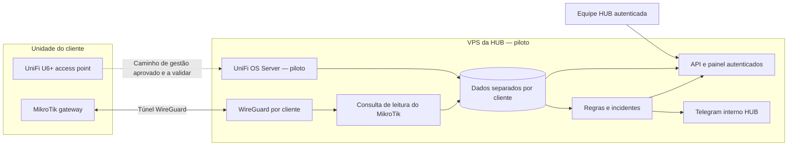

# Visão da arquitetura

## Direção e estado

**Confirmado:** endpoint e dashboard na VPS; múltiplos clientes; atender unidades com e sem computador sempre ligado. **Proposto:** desenho abaixo, componentes e protocolos. O código permanece na arquitetura local documentada no [[README]].

## Recomendação específica para UniFi

Consulte [[02 - Arquitetura/Recomendação de hospedagem UniFi]]. Não transferir todos os controladores para a VPS antes de identificar UDM/UCG, CloudKey, APs/switches e controladores atuais. Controlador UniFi e sistema HUB têm responsabilidades diferentes.

## Fluxo prioritário do MVP — consulta privada por WireGuard

Esta é a modalidade prioritária definida para o MVP sem computador: a VPS consulta o MikroTik por um túnel WireGuard e consulta o U6+ pelo controller compatível. A API de administração não deve ficar exposta publicamente. A consulta depende de túnel e energia/rede local; ausência de comunicação vira estado desconhecido/obsoleto e não prova queda de todos os equipamentos.

O HUB e o UniFi OS Server podem ficar na mesma VPS durante o piloto, somente após checagem de sistema operacional, recursos, portas/serviços, backups e recuperação. Esta decisão não define a hospedagem de produção. Se o preflight falhar, interromper a co-hospedagem e registrar alternativas para nova decisão.

## Modalidades a prever

| Modalidade | Requisitos | Cobertura e limite | Situação |
|---|---|---|---|
| A — agente/coletor local | Computador/servidor autorizado, ligado na janela de monitoramento e com acesso às redes necessárias | Pode medir caminhos originados no endpoint e manter fila local; se desligado, não mede | Evolução posterior; computadores não entram no MVP |
| B — coletor dedicado | Pequeno equipamento compatível e ligado na unidade; custo e manutenção a definir | Mantém coleta quando PCs desligam; ainda depende de energia/rede local | Alternativa futura, não escolhida para o MVP |
| C — consulta central por WireGuard | MikroTik compatível e ligado, túnel autorizado, endereçamento/rotas isolados e acesso restrito | Consulta MikroTik e controller sem PC; se túnel/WAN cair, telemetria fica indisponível; não fornece notebook → gateway | Prioridade escolhida para o MVP; configuração pendente |

O usuário confirmou a necessidade de locais com e sem computador e depois escolheu WireGuard como prioridade do MVP sem PC. Isso não autoriza configurar túneis, comprar hardware ou acessar redes de clientes. Validar compatibilidade e autorização unidade a unidade; não prometer cobertura idêntica.

Para C, dar a cada peer/cliente uma identidade e endereçamento de túnel próprios. Não instalar rotas amplas para LANs sobrepostas no mesmo namespace. Se a topologia exigir rotas conflitantes, interromper o onboarding e definir isolamento adicional; acrescentar `client_id` no banco não resolve colisão de rotas.

Sem WireGuard/integração compatível, a unidade fica **sem comunicação** ou **não monitorada**, conforme exista ou não sensor ativo. Não criar status a partir apenas de cadastro. A disponibilidade do controller e a do AP são sinais distintos; ausência da API UniFi marca o estado do AP como desconhecido/obsoleto, salvo evidência independente.

## Agentes nos computadores

Agentes de computador, coleta de CPU/RAM/disco e medições originadas no notebook ficam para etapa posterior. Quando entrarem, precisam usar identidade individual, TLS/fila e vínculo explícito com unidade; notebook que muda de rede não pode contaminar indicadores da loja. O túnel ou o controller não substitui a medição originada no endpoint.

O coletor e o agente têm papéis distintos, mesmo que possam futuramente compartilhar um pacote. A decisão de empacotamento vem depois do contrato de coleta.

## Responsabilidades na VPS

| Componente lógico | Responsabilidade |
|---|---|
| Entrada HTTPS | Certificados, limites de requisição e identidade dos sensores |
| Ingestão | Validar schema, escopo, horários, deduplicação e tamanho dos lotes |
| Persistência | Inventário, medições, estados, incidentes e auditoria por cliente/unidade |
| Processamento | Frescor dos dados, regras, correlação, agregações e retenção |
| API/painel | Login, autorização por cliente, consulta, histórico e administração |
| Notificações | Fila de entrega, deduplicação, recuperação e destino correto |
| Operação | Logs, métricas, backups, restauração e saúde da central |

São responsabilidades lógicas; não exigem microserviços. Para o piloto, avaliar aplicação modular e processos separados apenas quando necessário. Não escolher infraestrutura complexa sem medir volume.

## Identidade e contrato mínimo proposto

- Cliente → unidade → dispositivo; coletor e agente têm IDs próprios e credenciais revogáveis.
- Interfaces/links e alvos têm identidades estáveis; IP e hostname são atributos mutáveis.
- Credencial de ingestão vinculada no servidor ao cliente/unidade/sensor. Não aceitar escopo arbitrário informado pelo remetente.
- Evento: ID único no escopo do emissor, versão do schema, origem, destino, interface/rota quando aplicável, método, unidade, valor/estado, horário da medição e do recebimento, qualidade e erro categorizado.
- Identificação de sessão/reinício e sequência para evitar confundir retransmissão e nova amostra.
- Histórico fora de ordem não substitui automaticamente o estado mais recente; valores com relógio incoerente ficam identificados.
- Tenant/unidade em consultas, chaves, arquivos, caches, exportações, incidentes e notificações. Testar clientes com nomes/IPs iguais.

## Reaproveitamento e migração

O código observado tem SQLite e uma única configuração global de MikroTik/WAN; não há integração UniFi nem escopo multi-cliente nas consultas atuais. Reaproveitar apenas após adaptar modelo, autenticação, autorização e isolamento. O painel de monitoramento atual não deve ser publicado na VPS.

Para eventual migração: mapear unidade para cliente, emitir identidade/credencial escopada, manter origem/horário, definir corte e retorno. Para controller UniFi, exportar backup, restaurar/importar e confirmar o AP online no novo antes de retirar o antigo; migrar um cliente por vez. Não importar históricos automaticamente nesta etapa.

Tecnologias candidatas em [[02 - Arquitetura/Tecnologias/Stack atual]]. Operação em [[05 - Operação/Instalação e segurança]].
